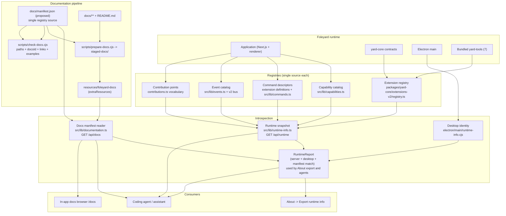

# Foleyard self-awareness and documentation architecture audit

> Status: audit — point-in-time finding, not current product documentation
> Scope: whole repository (application, desktop runtime, yard-core, yard-tools, docs, examples, CI)
> Baseline: checkout at commit `565ac1a` with an uncommitted cleanup in the working tree
> Constraint honoured: no application code was modified. This file is the only artefact written.
> Evidence rule: every claim below was verified against inspected source. Where documentation and source disagree, source wins and the contradiction is recorded in §3.1.

---

## 0. Prior audit context (important)

This is the **second** self-awareness audit. An earlier audit with the same filename existed at
`docs/audits/foleyard-self-awareness-audit.md`, dated 6 September 2026 against commit `f7e7edd`, and
it directly produced today's introspection layer. Its companion,
`docs/audits/self-awareness-completion-matrix.md` (also in git history, deleted in the working tree
as part of the archive move), recorded P0/P1/P2 delivery: `src/lib/capabilities.ts`,
`src/lib/runtime-info.ts`, `/api/runtime`, desktop runtime identity, the docs registry/staging
pipeline, `examples/core/query-library`, event/settings catalogs, and a *command table* in
`src/lib/commands.ts`.

This matters for three reasons:

1. **The machinery in §2 is deliberate, not accidental.** It was built to satisfy the earlier audit
   and should be adapted, not replaced.
2. **The drift is structural.** The earlier completion matrix predates the retirement work (PRs
   #220–#222: v1 app surface, v1 core engine, old component tree) and the Variant I promotion.
   When v1 was deleted, the v1-shaped docs, the `src/lib/commands.ts` table and the coexistence ADR
   were not re-synced. Four days later, the same audit is needed again. The missing ingredient is
   enforcement: there is still nothing that fails CI when docs, registries and removed code diverge.
3. **Claims of completion must be re-verified after every retirement.** The previous matrix declared
   D2 (contradictions corrected) and C5 (app command table) complete. Both are false in this
   checkout: `src/lib/commands.ts` no longer exists, and `docs/commands.md` is wrong again.

The prior audit is recoverable from git (`git show HEAD:docs/audits/foleyard-self-awareness-audit.md`)
and from the archive checkout. This document supersedes it as the current self-awareness baseline.

---

## 1. Executive summary

### 1.1 What is actually happening

The repository is not drowning in too many documents. It is mid-migration and the documentation
has not caught up with the migration:

1. **Version 1 was deleted, but v1 documentation was not.** The v1 extension engine, packages and
   routes were removed across PRs #220–#222 (`git log`: *"Delete the version 1 packages and core
   engine"*, *"Remove the version 1 extension system from the app"*). The working tree then removed
   `blog-posts/**` and the historical `docs/audits/**`, `docs/audit-2026-09/**`, `docs/plans/**`
   (146+ deletions, still uncommitted). Several registry documents still describe v1 as live:
   `docs/extensions.md` (labeled `current` but documents a retired system), `docs/settings.md`
   (entirely a removed stack), `docs/extensions-v2.md:19-21` ("v1 … keeps running untouched"),
   `docs/extensions-v2-migration.md` (self-contradictory cutover rules), and six tool READMEs.
2. **Three copies of the document registry exist and no CI check compares them.**
   `src/lib/documentation.ts` (`DOCUMENT_REGISTRY`), `scripts/prepare-docs.cjs` (hardcoded
   `DOCUMENTS`) and `scripts/check-docs.cjs` (its own copy). `check-docs` validates the staged
   manifest against its own copy, so adding a document to TypeScript without touching the scripts
   passes CI.
3. **The runtime introspection layer is far more complete than the repository realises, but parts
   of it are not true.** `GET /api/runtime` (`src/app/api/runtime/route.ts` →
   `src/lib/runtime-info.ts`) already reports identity, database, capabilities, events, settings
   refs, extensions, v2 events and docs location. Desktop identity exists over
   `desktop:get-runtime-info`. But `getDocumentationLocation()` hardcodes `matched: true`
   (`src/lib/documentation.ts:87`) and never reads the staged `manifest.json`; `FOLEYARD_SOURCE_REVISION`
   and `FOLEYARD_SOURCE_DIRTY` are read but set nowhere; and the capability catalog is disconnected
   from the execution host, which passes `capabilities: {}` (`src/lib/extensions-v2/host.ts:221`).
4. **Documentation drift is invisible to agents and CI.** `scripts/check-docs.cjs` checks only
   relative `.md` links. Source maps full of deleted paths are not validated. `docs/commands.md`
   documents 3 of the 35 bundled v2 commands and gives wrong built-in palette IDs. `docs/events.md`
   lists an event with no producer and one that references a service that does not exist.
5. **Design/experiment documents are mixed with shipped documentation.** `docs/component-library*.md`,
   `docs/variant-i-*.md`, `docs/test-*.md`, `docs/performance-improvement-plan.md`,
   root `redesign-plan.md` (gitignored) and `plan/**` (gitignored) sit beside registry docs with no
   enforced status separation. `DocumentStatus` supports `historical` and `experimental`, but every
   entry in the manifest is `current`.

The practical consequence the user reports — *"not easy to implement more stuff"* — has a concrete
cause: an agent that follows `AGENTS.md` into `docs/settings.md` or `docs/extensions.md` is sent to
deleted files; an agent that trusts `/api/runtime` is told the docs "match" without evidence; and an
agent that reads `docs/commands.md` learns an incomplete, partly wrong command surface. Adding a
feature requires editing up to five places (definition, registry, staged manifest, docs source map,
runtime projection) with only one of them (the command-ID scan) guarded by CI.

### 1.2 Scores

Scores are 0–5, where 0 = absent, 3 = usable but unreliable, 5 = authoritative and enforced.

| Area | Score | Explanation |
| --- | --- | --- |
| Documentation | **3** | 27 version-staged guides with a consistent house template (status/contract/owner/source map/failure/examples), an in-app browser, and a staging + validation pipeline. Undermined by v1-era staleness, orphaned design docs, and no enforcement that documented paths or IDs exist. |
| Architecture discoverability | **4** | `CONTEXT-MAP.md` + four `CONTEXT.md` contexts + ADRs + `docs/architecture/*` + per-doc source maps give a real map. `docs/architecture/application.md` and `docs/adr/new-surface-promotion.md` point at deleted paths; `docs/agents/domain.md:14` describes a `<context>/docs/adr/` convention that does not exist. |
| Extension discoverability | **4** | A genuine runtime registry (`packages/yard-core/src/extensions-v2/registry.ts`), serializable catalog over HTTP, seven bundled tool definitions, scaffold CLI, boundary check, and a runnable minimal example. Missing: any manifest concept, lifecycle hooks that actually execute, handler unregistration, and docs for the UI points that are not mounted. |
| Runtime introspection | **4** | `/api/runtime` is a genuinely good read-only snapshot (never executes handlers, never opens/creates the DB for identity, explicit limitations). Gaps: docs manifest is not consumed, `matched` is hardcoded, capabilities are inert, server and desktop identity disagree on build ID, and the renderer is reported absent by design. |
| Agent self-awareness | **3** | `AGENTS.md` routes to subsystem docs and `docs/runtime.md` documents a read-only agent workflow (`/api/runtime` → verify identity → `docs/index.md` → subsystem guide). The routing table points at two stale documents, and there is no status/archive policy that agents can trust without reading code. |
| Example coverage | **2** | Two examples (`examples/core/query-library`, `examples/extensions-v2/minimal`), both typechecked and executed in CI, both referenced by the docs manifest. But the examples list is hardcoded in three places, nothing validates it, and there is no example for UI contributions, settings, jobs or plans. |
| API documentation | **4** | Subsystem contracts, failure tables, status codes, limits and source maps are consistently documented; `docs/extensions-v2.md` is a strong authoring reference. `docs/commands.md` is materially wrong (3/35 commands, wrong palette IDs), `docs/events.md` contains phantom entries, and `docs/settings.md` documents a deleted API. |

**Overall: infrastructure 4/5, truthfulness 2.5/5.** Foleyard already has most of the architecture the
target model asks for. The dominant problem is not missing machinery; it is unverified, unenforced
and partly stale metadata.

### 1.3 The target model, stated for Foleyard

Foleyard should be able to answer — from runtime state and version-matched docs, not from the
checkout — the questions "what am I, what version, what can I do, what is loaded, what commands
exist, what is public, where are the docs, where are examples, what is shipped vs experimental vs
proposed". The repository already contains every input needed for that answer. The work is to make
one source per fact, verify it in CI, and expose it through the existing snapshot.

---

## 2. Existing architecture

### 2.1 Application (Next.js App Router, `src/`)

- Renderer/workspace: `src/app/(variant-i)/page.tsx` (the promoted Variant I workspace),
  `src/app/(variant-i)/components/**` (rail, file table, organize, dialogs, palette, player,
  settings tabs, extension flows).
- Component library: `src/components/**` (AudioPlayer, CommandPalette, FileTable, FileTable actions,
  settings primitives, `ui/**`) plus `src/components/variant-i/**` primitives and
  `src/components/extensions-v2/**` generic v2 renderers (some unused, see §4).
- Hooks/types: `src/app/library/use-*.ts`, `src/lib/**`, `src/types/**`.
- HTTP API: `src/app/api/**` — files, directories, tags, collections, settings, scan, audio,
  waveform, desktop grants/path/file, docs, runtime, and `extensions-v2/**` (the largest surface).
- Documentation surface: `src/app/docs/page.tsx`, `src/app/docs/[...id]/page.tsx`,
  `src/app/docs/docs-browser.tsx`, `src/components/markdown.tsx`.

### 2.2 Desktop runtime (`electron/`)

- `electron/main.cjs`, `electron/preload.cjs`, `electron/main/**` (window, IPC, next-server,
  auto-updater, database, desktop-service, errors, runtime-info, constants, server-url).
- IPC contract registry: `electron/main/ipc-channels.cjs` (`CHANNEL_SPECS`: 13 invoke, 1 send,
  7 event channels).
- Desktop identity: `electron/main/runtime-info.cjs` (`getDesktopIdentity`: platform, packaged,
  app version, BUILD_ID, resources/docs paths, installed channels).
- Build: `electron-builder.yml` packages `.next` + `electron` and stages docs as
  `resources/foleyard-docs` (`extraResources`, lines 31–33).

### 2.3 Core contracts (`packages/yard-core/`)

- Domain: `src/domain/{audio-file,collection,filename,library,playback,search,tag}.ts`.
- Services/repositories: `src/services/**` (library scanner, organization, search),
  `src/repositories/**` (implemented by the app's SQLite repositories).
- Extension v2 engine: `src/extensions-v2/**` — definition, registry, catalog, availability,
  permissions, grants, filesystem guards, operations, extended-operations, host, jobs, plans,
  extension-data, events, contributions, transport, version, diagnostics, invocation, selection.
- Version separation is explicit and documented in `src/extensions-v2/version.ts`: API version
  (`2`), package version, product version, runtime schema version are four distinct things.

### 2.4 Bundled tools (`packages/yard-tools/`)

Seven v2 ports, each a package with `definition.ts`, `handlers.ts`, `policy.ts` (where applicable),
tests and README: `sound-shelf-v2`, `make-pack-v2`, `drop-rules-v2`, `folder-janitor-v2`,
`library-gatherer-v2`, `smart-collections-v2`, `auto-tag-v2`. Total: 35 commands; 23 exposed as
palette contributions; 8 contribution point types declared.

### 2.5 Application extension adapters (`src/lib/extensions-v2/`)

`host.ts` (production registry composition + enablement + `globalThis` persistence),
`contributions.ts` (renderer catalog fetch/cache and point resolution), `events.ts`, `enablement.ts`,
`settings-state.ts`, `library-ports.ts`, `policy.ts`, `jobs.ts`, `job-client.ts`,
`source-grants.ts`, `filesystem.ts`, `recent-source-store.ts`, tool wiring modules
(`sound-shelf-v2.ts`, `make-pack-v2.ts`, …), dev fixtures.

### 2.6 Introspection primitives (today)

| Concern | Implementation | State |
| --- | --- | --- |
| Product/version identity | `src/lib/runtime-info.ts` (`getServerRuntimeSnapshot`), `electron/main/runtime-info.cjs` | Exists |
| Build/source identity | `.next/BUILD_ID`, `FOLEYARD_SOURCE_REVISION`, `FOLEYARD_SOURCE_DIRTY` | Partial — env vars never set |
| Database/schema | `src/lib/database/migrations.ts` (`getDatabaseVersionInfo`) | Exists |
| Capabilities | `src/lib/capabilities.ts` (`CAPABILITIES`, `describeCapabilities`) | Exists but descriptive-only; host passes `{}` |
| Commands | v2 catalog (`packages/yard-core/src/extensions-v2/catalog.ts`, `GET /api/extensions-v2`); built-ins hardcoded in `src/components/CommandPalette/command-palette.ts` | Partial — v2 enumerable, built-ins not |
| Events | `src/lib/events.ts` (`EVENT_CATALOG`), v2 bus `packages/yard-core/src/extensions-v2/events.ts` | Partial — catalog entries inaccurate, bus server-only |
| Extensions | v2 registry + enablement + `/api/runtime.extensionsV2` | Exists — bundled only, no manifest |
| UI extension points | `packages/yard-core/src/extensions-v2/contributions.ts` point vocabulary + `resolveV2UiPoint` | Partial — 8 declared, 4 mounted |
| Settings schema | `src/lib/settings-schema.ts` (refs only) + per-definition settings in catalog | Partial |
| Docs location/read | `src/lib/documentation.ts`, `GET /api/docs`, staged manifest | Partial — manifest never read |
| Examples location | hardcoded in `src/lib/documentation.ts:90-93` and `scripts/prepare-docs.cjs:53-56` | Partial — duplicated |

### 2.7 Docs and examples pipeline

- Source registry: `src/lib/documentation.ts` (`DOCUMENT_REGISTRY`, 27 entries; `DocumentStatus =
  current | historical | experimental`).
- Staging: `scripts/prepare-docs.cjs` → `staged-docs/foleyard-docs/{manifest.json, README.md, docs/**}`.
- Validation: `scripts/check-docs.cjs` (registry sources exist; manifest identity; staged hashes;
  relative `.md` links; v2 command-ID scan in staged `commands.md`).
- Bundling: `electron-builder.yml` `extraResources` → `resources/foleyard-docs`; runtime resolution
  in `src/lib/documentation.ts:66-80` (`FOLEYARD_DOCS_ROOT` → `resourcesPath/foleyard-docs` →
  workspace root).
- CI: `.github/workflows/check.yml` runs typecheck, lint, test, coverage, build, expected-failures,
  v2 boundaries, `docs:prepare`, `docs:check`, and both examples. `release.yml` stages docs *before*
  `next build`, so released manifests carry `buildId: null`.
- Examples: `examples/core/query-library/` (direct Sqlite query) and `examples/extensions-v2/minimal/`
  (real v2 registry + host, four cases).

---

## 3. Existing documentation inventory

Legend: **Accuracy** = Good / Partial / Stale / Historical / Generated. **Registry** = listed in
`src/lib/documentation.ts` and the staged manifest.

### 3.1 Registry documents (served by `/api/docs` and bundled)

| Document | Purpose | Accuracy | Problems | Action |
| --- | --- | --- | --- | --- |
| `README.md` | Product overview | Partial | Says seven tools "extend the workspace in-process through the internal v2 extension API" (accurate); links only v2 docs; omits status vocabulary | Keep; add status/routing line |
| `docs/index.md` | Documentation index + status table | Partial | Claims all members are `current`; lists moved `docs/audits/`, `docs/plans/`, `docs/audit-2026-09/`; agent workflow depends on unverified `matched` | Rewrite from a single manifest; mark statuses honestly |
| `docs/quickstart.md` | First-run user path | Partial | `src/components/AudioPlayer/player-shell.tsx` deleted; "largest unexecuted file, 252 stmts" stale; false "no examples directory"; lists three examples, manifest has two | Fix paths/claims |
| `docs/development.md` | Contributor loop | Partial | "12-entry ledger" vs 8 actual; `extensions/selected-ids` example deleted; baseline numbers stale | Fix; link live ledger |
| `docs/library.md` | Library model/API | Partial | Deleted `player-shell.tsx` reference in related paths; false "no examples"; 252-stmt claim | Fix |
| `docs/scanning.md` | Scan lifecycle | Partial | Claims B06 5,000-file cap expected-to-fail although fixed and removed from ledger (§development.md:91-96); false no-examples | Fix |
| `docs/metadata.md` | Metadata parsing/storage | Partial | False "no examples directory" | Fix |
| `docs/playback.md` | Playback/waveforms | Stale | Deleted `make-pack-recent-store.ts`, deleted `player-shell.tsx`; FFmpeg-only description contradicts direct PCM path; false no-examples | Rewrite source map |
| `docs/search.md` | Search semantics | Partial | False no-examples; count disagreement recorded in performance plan | Fix |
| `docs/collections.md` | Collections/tags/shelf | Partial | False no-examples; deleted `extensions/selected-ids` example | Fix |
| `docs/filesystem.md` | FS grants/boundaries | Stale | Cites deleted `extension-host.ts`; claims E01/E04/B12 expected-to-fail (fixed/removed); dead example | Rewrite |
| `docs/settings.md` | Settings storage/validation | Stale | Entire v1 stack deleted (`src/settings.ts`, `src/lib/extensions/{kv,settings}-store.ts`, `/api/extensions`); "v1 flow untouched" false | Replace with v2/extension + renderer prefs doc |
| `docs/database.md` | DB/drizzle/migrations | Partial | Says migration records version 1; `CURRENT_SCHEMA_VERSION = 2` in `src/lib/database/migrations.ts` | Fix |
| `docs/extensions.md` | Bundled tools | Stale | Registry-labeled `current`; entire source map deleted (`src/lib/extensions/**`, core `extensions/**`, `/api/extensions`); example missing; contradicts `architecture/extensions.md` | Retire: mark `historical` or fold useful content into `extensions-v2.md` |
| `docs/extensions-v2.md` | v2 authoring/API | Good/Partial | Lines 19–21 claim v1 "keeps running untouched"; related-links line 344 says "v1 commands beside these v2 contracts"; example 8 (renderer subscribe) cannot work (bus is server-only, no SSE) | Fix v1 residue; constrain example 8 to server context |
| `docs/extensions-v2-migration.md` | v1→v2 migration record | Partial | Self-contradictory sections ("never changes v1 behavior", "v1 and v2 coexist", "the six v1 tools") after full retirement; missing `public/extension-system-v2.html` | Rewrite as retirement record |
| `docs/extensions-v2-make-pack.md` | Reference walkthrough | Partial | "original Make Pack keeps its behavior"; v1 B12 expected-to-fail claim; wrong dialog path | Fix |
| `docs/extensions-v2-troubleshooting.md` | Failure diagnosis | Good | "v1 events" phrasing | Minor fix |
| `docs/commands.md` | Command inventory/API | Stale | Built-in palette IDs wrong (`view:toggle-playback` etc. do not exist); table lists 3 of 35 commands; "every port has a settings namespace" (auto-tag has none); source map incomplete | Rewrite; generate/validate command table |
| `docs/events.md` | Event catalog | Partial | Lists `desktop-bridge-ready` (no emitter), `extension.scan-progress` (no `services.scanProgress` in code), missing `desktop:action-error` payload ref; omits scan `onComplete` and NDJSON progress helper | Correct catalog to code |
| `docs/runtime.md` | Introspection guide | Partial | About-tab path `src/components/settings/about-tab.tsx` does not exist (actual: `src/app/(variant-i)/components/settings/about-tab.tsx`); relies on hardcoded `matched: true` | Fix path; real match semantics |
| `docs/architecture/application.md` | App layering/routes | Stale | `src/app/prototype/legacy-app/page.tsx` deleted; `use-shelf.ts`, `use-extension-catalog.ts`, `dialogs.ts` names wrong | Fix source map |
| `docs/architecture/desktop.md` | Electron/IPC architecture | Good | — | Keep |
| `docs/architecture/yard-core.md` | Core contracts | Good | — | Keep |
| `docs/architecture/extensions.md` | Registration→pixels trace | Good/Partial | Claims generic forms/previews/results render; app uses hand-built dialogs; dead `public/extension-system-v2.html` link; says v1 removed (correct, unlike `extensions.md`) | Fix UI claim + diagram link |
| `docs/adr/filesystem-access.md` | FS grant decision | Good | — | Keep; register status |
| `docs/adr/new-surface-promotion.md` | Variant I promotion decision | Stale | Parks `src/app/prototype/legacy-app/page.tsx` and calls it compilable; path deleted | Update to actual promotion; mark superseded sections |

### 3.2 Non-registry repository documents

| Document | Category | Accuracy | Problems | Action |
| --- | --- | --- | --- | --- |
| `docs/adr/README.md` | ADR index | Partial | Omits `new-surface-promotion.md`; coexistence ADR still listed as active | Update index |
| `docs/adr/extension-v2-coexistence.md` | ADR | Stale | Decision "v2 ships beside v1" is false post-retirement; still cited by migration doc as owner | Supersede with retirement ADR |
| `docs/adr/extension-v2-dependency-direction.md` | ADR | Good | References "v1 extension module" historically | Keep |
| `docs/adr/extension-v2-permissions-trust.md` | ADR | Good | — | Keep |
| `docs/adr/extension-v2-jobs-recovery.md` | ADR | Good | — | Keep |
| `docs/agents/domain.md` | Agent instruction | Partial | `<context>/docs/adr/` convention does not exist anywhere | Fix convention |
| `docs/agents/issue-tracker.md` | Agent instruction | Good | — | Keep |
| `docs/agents/triage-labels.md` | Agent instruction | Good | — | Keep |
| `docs/expected-failures.md` | Live ledger | Good | 8 entries matching `scripts/check-expected-failures.cjs`; not in docs manifest | Register in manifest |
| prior `docs/audits/foleyard-self-awareness-audit.md` (6 Sep 2026) | Historical audit | Historical | Superseded by this file; recoverable from git/archive; its completion matrix over-claimed after v1 retirement | Keep in `Daelars/foleyard-archive` |
| prior `docs/audits/self-awareness-completion-matrix.md` | Historical ledger | Historical | Declared P0–P2 complete; `src/lib/commands.ts` since deleted and doc contradictions re-appeared | Keep in archive as a case study |
| `docs/test-coverage-baseline.md` | Historical snapshot | Historical | Dated 5 Sep 2026; superseded counts | Move to archive checkout |
| `docs/test-suite-target-shape.md` | Historical plan | Historical | Target 50 tests; suite far beyond | Move to archive |
| `docs/performance-improvement-plan.md` | Experiment log | Current-ish | Machine-generated; broken `../benchmarks/performance/benchmark-results.json` link; not registered | Keep outside registry or archive when done |
| `docs/component-library.md` | Implementation note | Stale | Describes `src/components/ui` as canonical post-Variant-I; orphan | Move to archive |
| `docs/component-library-agent-prompt.md` | Historical brief | Historical | Self-declared design proposal; dead paths | Move to archive |
| `docs/component-library-agent-prompt-redesign.md` | Historical brief | Historical | Self-declared design proposal; dead paths | Move to archive |
| `docs/variant-i-app-v3-coverage.md` | Promotion record | Partial | Promotion note current; body references deleted routes/components | Split: keep promotion note; archive body |
| `docs/variant-i-app-v3-implementation-prompt.md` | Historical brief | Historical | Dead prototype paths | Move to archive |
| `docs/variant-i-screenshots/*.png` | Evidence assets | Current | Referenced by coverage doc only | Keep with promotion note or archive |
| `redesign-plan.md` | Implementation note | Stale | Gitignored; pre-Variant-I plan; dead paths | Leave ignored; never route agents to it |
| `plan/extension-format/**`, `plan/table/**` | Prototype notes | Stale | Gitignored; v1-era manifest/UI plans | Leave ignored |
| `staged-docs/**` | Generated output | Generated | Duplicates docs; `development.md` copy stale in working tree | Never edit by hand; regenerate |
| `dist-electron/**/foleyard-docs/**` | Build output | Generated | Packaged copy | Never edit |
| `AGENTS.md` | Agent routing | Good | Points at `docs/settings.md` and `docs/extensions.md` (stale); no status/archive policy | Extend routing (§11) |
| `CONTEXT-MAP.md` | Domain map | Good | — | Keep |
| `src/CONTEXT.md`, `electron/CONTEXT.md`, `packages/yard-core/CONTEXT.md`, `packages/yard-tools/CONTEXT.md` | Domain language | Good | yard-core lists retired `extensions/` correctly | Keep |
| `RELEASE.md` | Release runbook | Good | v2-only extension notes | Keep |
| `packages/yard-tools/README.md` | Tool catalog | Partial | Calls `docs/commands.md` a "retired-command table" | Fix |
| `packages/yard-tools/*-v2/README.md` (6 of 7) | Extension docs | Partial | Opening paragraphs assert the v1 tool "keeps its routes and behavior untouched" (deleted) | Fix openings |
| `src/components/variant-i/README.md` | Primitive catalogue | Good | Points at current `(variant-i)` paths | Keep |
| `examples/core/query-library/README.md` | Example | Good | — | Keep |
| `examples/extensions-v2/minimal/README.md` | Example | Good | — | Keep |
| `scripts/performance/README.md` | Dev benchmark | Good | — | Keep |
| `.github/workflows/check.yml` | CI | Good | Docs check present but shallow (see §3.1 gaps) | Extend |
| `.github/workflows/release.yml` | Release CI | Partial | Stages docs before `next build` → `buildId: null`; skips examples/typecheck | Fix order; run shared checks |

### 3.1.1 Recorded contradictions (source wins)

1. `docs/extensions.md` (status `current`) vs `docs/architecture/extensions.md:12` and
   `docs/extensions-v2.md` v1 claims — the v1 code does not exist; v2 is the only runtime.
2. `docs/extensions-v2.md:19-21` "v1 … keeps running untouched" vs `git log` #221/#222 and missing
   `packages/yard-tools/*` non-v2 packages.
3. `docs/settings.md` source map vs missing `src/lib/extensions/*` and `src/app/api/extensions/*`.
4. `docs/commands.md:55-59` built-in palette IDs vs `src/components/CommandPalette/command-palette.ts:70-238`
   and `src/components/Shortcuts/shortcuts.ts:11-27`.
5. `docs/database.md` "records version 1" vs `CURRENT_SCHEMA_VERSION = 2`
   (`src/lib/database/migrations.ts`).
6. `docs/runtime.md:29,102,106` About-tab path vs actual
   `src/app/(variant-i)/components/settings/about-tab.tsx`.
7. `docs/scanning.md:62-63` B06 expected-to-fail vs `docs/development.md:91-96` (fixed, removed) and
   `scripts/check-expected-failures.cjs` (8 entries, none B06).
8. `docs/filesystem.md:77-85` E01/E04/B12 expected-to-fail + `extension-host.ts` vs fixed/removed in
   `docs/development.md` and absent from the ledger.
9. `docs/playback.md` FFmpeg-only waveform description vs direct JS PCM decode path recorded as a
   mismatch in `docs/performance-improvement-plan.md`.
10. `docs/index.md:100` status table vs `DOCUMENT_REGISTRY` (all entries `current`) and the manifest
    (all 27 `status: "current"`).

---

## 4. Gap analysis: target vs current

| Area | Target | Current Foleyard | Gap | Priority |
| --- | --- | --- | --- | --- |
| Runtime identity | Machine-readable identity, revision and build, installed vs checkout | `/api/runtime` server snapshot + desktop identity; `packaged` is `undefined` in desktop mode; revision env never set; two BUILD_ID paths (`process.cwd()` vs `app.getAppPath()`) | Unify provenance; set revision/dirty at build; reconcile build IDs | P0 |
| Docs version match | Docs are provably matched to the running version | `matched: true` hardcoded; `manifest.json` with versions, hashes, revision is written but never read at runtime; release manifests have `buildId: null` | Read manifest, report real match/mismatch, fix release staging order | P0 |
| Docs source of truth | One registry consumed by scripts, runtime and staging | Three copies (`documentation.ts`, `prepare-docs.cjs`, `check-docs.cjs`); no equality test | Single manifest source + equality check | P0 |
| Documentation accuracy | Every registry doc describes shipped code or is labeled otherwise | 3 registry docs essentially stale (`settings.md`, `extensions.md`, partly `playback.md`); `historical`/`experimental` statuses unused | Truth pass + statuses + source-map validation in CI | P0 |
| Capability registry | Central, machine-readable, connected to execution | `CAPABILITIES` (18 ids) exists; no extension declares `requiredCapabilities`; host/availability/UI pass `capabilities: {}`; 7 extension permission ids absent from `requiredPermissions` | Either wire the catalog into composition or mark it descriptive-only and validate docsIds | P1 |
| Commands | Enumerated registry with availability and handler | v2 catalog is enumerable (35 commands); built-in palette actions hardcoded in `buildPaletteEntries`; stale `src/lib/commands.ts` comment; `/api/runtime` omits `destructive`, `input`, `result`, `docsId` | Extract built-in command descriptors; include built-ins in snapshot; fix `docs/commands.md` | P1 |
| Events | Documented, accurate public catalog separated from internals | `EVENT_CATALOG` (11) plus v2 bus (5); catalog has a phantom event, a phantom service, a missing payload and omissions | Correct the catalog; mark internal callbacks clearly | P1 |
| Extensions | Discoverable runtime extensions with lifecycle | Registry/catalog/enablement/permissions/jobs/plans all exist and are bundled-only; no manifest (not needed for bundled code); `onEnabled`/`onDisabled` validated but never invoked; no handler unregistration; registration failure not isolated | Implement or delete hooks; isolate registration; unregister handlers | P2 |
| UI extension points | Documented points that actually mount | 8 declared types; palette, context-menu, selection-actions, drop-menu mounted; `sidebar` component exists but is never imported; `toolbar` unmounted; `settings` point never resolved; generic forms/previews not used | Mount sidebar, correct docs for toolbar/settings, delete or fixture-label dead generics | P1 |
| Docs | Bundled authoritative docs | 27 docs staged into `resources/foleyard-docs`, in-app browser, `/api/docs` | Relative links not rewritten in-app; browser hides examples/runtime match | P2 |
| Examples | Working, versioned, validated examples | 2 examples, CI-run and typechecked | List hardcoded in 3 places; no docs-tooling validation; no UI/settings/job example | P2 |
| Agent awareness | Small routing doc + introspectable runtime | `AGENTS.md` routing exists; `docs/runtime.md` documents the workflow | Routes to stale docs; no status/archive enforcement; no single `RuntimeReport` for agents to consume | P1 |
| Extension manifest files | (Not applicable) | Bundled static registration; catalog is the manifest | None — do not invent a manifest for its own sake | P3 |
| Public SDK / automation | Only if intentionally public | Everything is `internal`; no public stability promise | Do not create public API docs for internal contracts | P3 |

---

## 5. What Foleyard already does well

Do not replace these:

1. **A real, framework-free extension engine.** `packages/yard-core/src/extensions-v2/` separates
   definitions (pure data), registry validation, availability, permissions, host execution, jobs,
   plans and transport. Definitions are JSON-safe by construction (`catalog.ts` `assertJsonSerializable`).
2. **Pure, shared availability evaluation.** `evaluateV2Availability` is used by the catalog, the
   availability route, execution preflight, plan apply and renderer resolution — one semantic.
3. **Four separate version concepts, explicitly documented** in
   `packages/yard-core/src/extensions-v2/version.ts`: API version, package version, product version,
   runtime schema version.
4. **Read-only runtime introspection that never mutates.** `getServerRuntimeSnapshot` never executes
   handlers, reads approvals through a short-lived read-only SQLite handle, and degrades explicitly
   instead of creating the database.
5. **Explicit limitations.** `/api/runtime.limitations` and the docs state the trust model, the
   absence of external loading, renderer blind spots and cooperative cancellation.
6. **Version-staged docs with a real pipeline.** `prepare-docs` → `check-docs` → `extraResources` →
   `FOLEYARD_DOCS_ROOT`/`resourcesPath` resolution; docs are bundled outside ASAR and resolved
   identically in dev and packaged builds.
7. **A consistent documentation house style.** Status/contract/owner header, responsibilities,
   runtime behaviour, contracts, failure behaviour, source map, examples, related docs.
8. **Domain language and context map.** `CONTEXT-MAP.md`, four `CONTEXT.md` files and ADRs give
   agents an "avoid these words, own this concept" vocabulary.
9. **CI that already runs docs checks and examples.** `.github/workflows/check.yml` runs
   `docs:prepare`, `docs:check`, `example:v2-minimal` and the core query example.
10. **Boundary enforcement.** `scripts/check-v2-boundaries.cjs` prevents extension packages from
    importing app internals in CI.
11. **A runnable extension example that uses the real engine.**
    `examples/extensions-v2/minimal/run.ts` exercises serialization, enablement, execution and input
    validation against the production registry and host.
12. **A working in-app docs browser** (`/docs`) with deep links, grouping, filtering and markdown
    rendering from the same registry that stages the bundle.

---

## 6. Missing pieces

### Required (the system is untrustworthy without these)

1. One documentation manifest consumed by the TypeScript registry, the stager and the checker, with
   a CI equality assertion.
2. A truth pass that fixes or retires the stale registry docs and uses `historical`/`experimental`
   statuses honestly.
3. CI validation of source-map paths and `docsId` links inside registry docs (not only `.md` links),
   so agents cannot be routed to deleted files.
4. Runtime reading of the staged `manifest.json`, with a real `matched` verdict (product version,
   build ID, revision) instead of `matched: true`.
5. Identity unification: set `FOLEYARD_SOURCE_REVISION`/`DIRTY` during desktop builds, use one
   BUILD_ID source, and fix the release workflow to stage docs after `next build`.
6. Correct `docs/commands.md` and `docs/events.md`, or mark them generated and derive them from the
   registries.

### Recommended (large improvement per unit of work)

7. Extract built-in palette commands into one descriptor table (the file `src/lib/commands.ts`
   already referenced by a stale comment) and include built-ins in `/api/runtime`.
8. Connect `CAPABILITIES` to the host/availability/renderer composition (or explicitly declare the
   catalog descriptive-only and remove the dead `requiredPermissions` field semantics).
9. Implement or delete `onEnabled`/`onDisabled`; isolate registration failures; add handler
   unregistration or document that unload is not a supported operation.
10. Mount the `sidebar` point (component exists), and correct the docs claims for `toolbar` and
    `settings` points; delete dead generic renderers or mark them fixture-only.
11. Generate the `examples` array from `examples/**/README.md` and validate it in `check-docs`.
12. Register the live ledgers (`expected-failures.md`) in the manifest so they ship with the
    version-matched docs; archive experiment documents instead of leaving them next to guides.
13. Rewrite relative `.md` links in the docs browser to `/docs/<id>` so the served docs stay
    navigable.

### Optional (only if a real consumer appears)

14. A single `RuntimeReport` merged server + desktop object for the About export and agents
    (currently two nested objects).
15. Document search across the served docs; an agent-oriented HTTP index of commands/events already
    exists at `/api/runtime`.
16. Exposing runtime/docs to an MCP server or similar automation surface.
17. Generated API reference from `buildCatalog` (the catalog is already serializable).
18. Extension-scoped docs routes (the catalog carries `docsRefs`, currently unconsumed).

---

## 7. Proposed architecture



Key property: **solid arrows are derived, never hand-maintained.** The proposed additions are the
single `docs/manifest.json`, the `RuntimeReport` merge, and the capability/command wiring. Everything
else already exists and must not be replaced.

---

## 8. Proposed file changes

| Path | Action | Reason | Priority |
| --- | --- | --- | --- |
| `docs/manifest.json` (proposed) | Add | Single registry source for id, path, title, status, audience; consumed by TS, stager and checker | P0 |
| `src/lib/documentation.ts` | Modify | Import the manifest; read staged manifest at runtime; compute real `matched`; remove hardcoded examples list | P0 |
| `scripts/prepare-docs.cjs` | Modify | Delete the duplicated `DOCUMENTS` table; read `docs/manifest.json`; stage manifest metadata | P0 |
| `scripts/check-docs.cjs` | Modify | Delete its registry copy; assert equality with manifest; validate source-map paths, `docsId` links, example directories; keep command-ID scan | P0 |
| `docs/settings.md` | Rewrite | Current content documents a deleted v1 settings stack | P0 |
| `docs/extensions.md` | Retire/Merge | Registry-labeled `current` but documents retired v1; keep only if marked `historical`, otherwise fold into `extensions-v2.md` | P0 |
| `docs/commands.md` | Rewrite | Wrong built-in IDs; 3/35 commands; false settings claim | P0 |
| `docs/events.md` | Modify | Remove phantom entries; add missing payload/omissions | P0 |
| `docs/playback.md`, `docs/quickstart.md`, `docs/library.md`, `docs/scanning.md`, `docs/filesystem.md`, `docs/metadata.md`, `docs/search.md`, `docs/collections.md`, `docs/database.md`, `docs/runtime.md`, `docs/development.md` | Modify | Deleted paths, false "no examples", fixed expected-failures, wrong About path, version claims | P0 |
| `docs/architecture/application.md`, `docs/adr/new-surface-promotion.md`, `docs/adr/README.md`, `docs/agents/domain.md` | Modify | Deleted legacy-app path, missing ADR index entry, nonexistent context ADR convention | P1 |
| `docs/adr/extension-v2-coexistence.md` | Supersede | Coexistence decision is false post-retirement; add retirement ADR or update in place | P1 |
| `docs/extensions-v2.md`, `docs/extensions-v2-migration.md`, `docs/extensions-v2-make-pack.md`, six `packages/yard-tools/*-v2/README.md` | Modify | Remove "v1 keeps running" residue; constrain event subscribe example to server context | P1 |
| `src/lib/runtime-info.ts` | Modify | Add manifest match, capability set from composition, richer command fields, corrected `packaged` semantics | P0 |
| `electron/main/runtime-info.cjs` | Modify | Align BUILD_ID resolution; include revision provenance | P1 |
| `package.json`, `.github/workflows/release.yml`, `.github/workflows/check.yml` | Modify | Run `docs:prepare` after `next build`; set revision/dirty env; keep shared checks on release | P1 |
| `src/lib/capabilities.ts` | Modify | Reconcile `requiredPermissions` with extension permission ids; validate `docsId`s | P1 |
| `src/lib/extensions-v2/host.ts`, `src/app/api/extensions-v2/availability/route.ts`, `src/app/(variant-i)/page.tsx` | Modify | Replace hardcoded `capabilities: {}` with the derived available set (or document the catalog as descriptive-only and delete the plumbing) | P1 |
| `src/lib/commands.ts` (proposed) | Add | Built-in command descriptors (id, title, section, availability, execute) | P1 |
| `src/app/library/use-palette.ts`, `src/components/CommandPalette/command-palette.ts` | Modify | Consume descriptors; delete duplicated dispatch; include built-ins in snapshot | P1 |
| `packages/yard-core/src/extensions-v2/definition.ts`, `packages/yard-core/src/extensions-v2/host.ts`, `src/lib/extensions-v2/host.ts` | Modify | Implement or remove lifecycle hooks; add handler unregistration; isolate registration failures | P2 |
| `src/app/(variant-i)/components/extensions/sidebar-panels.tsx` + `src/app/(variant-i)/page.tsx` | Modify | Mount the existing sidebar point; then correct toolbar/settings docs or mount them | P1 |
| `src/components/extensions-v2/menus.tsx`, `src/components/extensions-v2/settings.tsx` | Delete or mark fixture-only | Dead generic renderers contradict "generic components render forms" documentation | P2 |
| `src/app/docs/docs-browser.tsx`, `src/components/markdown.tsx` | Modify | Rewrite relative `.md` links to `/docs/<id>`; surface manifest match and examples | P2 |
| `docs/component-library*.md`, `docs/variant-i-app-v3-implementation-prompt.md`, `docs/test-coverage-baseline.md`, `docs/test-suite-target-shape.md` | Move to `Daelars/foleyard-archive` | Historical/design material must not sit beside current guides | P1 |
| `docs/expected-failures.md` | Register in manifest | Live ledger referenced by `development.md`; should ship version-matched | P2 |
| `examples/extensions-v2/settings/` (proposed, name TBD) | Add | Second extension example exercising settings + context-menu contribution | P2 |
| `src/test/integration/documentation-bundle.test.ts`, `src/test/integration/extension-v2-repo-contracts.test.ts` | Modify | Assert manifest equality, `docsId` resolvability, real match semantics | P1 |

All paths above exist today except the rows marked *(proposed)*.

---

## 9. Proposed `/docs` tree

Only categories with real content are kept. The candidate structure's `sdk.md`, `automation.md`,
`extension-manifest.md`, `permissions.md`, `ui-extension-points.md`, `packaging-extensions.md`,
`ipc.md`, `migrations.md`, `audio-formats.md` are deliberately **not** created: the content lives in
`extensions-v2.md` sections, `architecture/desktop.md`, `database.md` and `playback.md`. Create them
only when they carry standalone value.

```text
docs/
├── manifest.json                        # NEW: single registry source (id, path, title, status, audience)
├── index.md                             # rewritten from manifest; honest per-doc status
├── quickstart.md
├── development.md
├── library.md
├── scanning.md
├── metadata.md
├── playback.md
├── search.md
├── collections.md
├── filesystem.md
├── settings.md                          # rewritten: renderer prefs + v2 extension settings
├── database.md
├── commands.md                          # rewritten; validated against command registries
├── events.md                            # corrected catalog
├── runtime.md                           # agent workflow; real manifest matching
├── extensions.md                        # RETIRE: tombstone/historical, or delete and redirect
├── extensions-v2.md                     # authoring contract (add UI points + permissions sections)
├── extensions-v2-migration.md           # rewritten as a retirement record
├── extensions-v2-make-pack.md
├── extensions-v2-troubleshooting.md
├── expected-failures.md                 # live ledger, registered
├── architecture/
│   ├── application.md
│   ├── desktop.md
│   ├── yard-core.md
│   └── extensions.md
├── adr/
│   ├── README.md
│   ├── filesystem-access.md
│   ├── new-surface-promotion.md
│   ├── extension-v2-coexistence.md      # superseded status
│   ├── extension-v2-dependency-direction.md
│   ├── extension-v2-jobs-recovery.md
│   └── extension-v2-permissions-trust.md
├── agents/
│   ├── domain.md
│   ├── issue-tracker.md
│   └── triage-labels.md
└── audits/
    └── foleyard-self-awareness-audit.md # this report; historical once acted on; archive-bound
```

Moved out of `docs/` into `Daelars/foleyard-archive`: `component-library*.md`,
`variant-i-app-v3-implementation-prompt.md`, `test-coverage-baseline.md`,
`test-suite-target-shape.md`, `performance-improvement-plan.md` (once experiments settle), and the
old variant-i body (keep only a short promotion note). `src/app/prototype/**` stays experimental and
excluded from docs/coverage, as today.

Document ownership per guide (purpose / audience / source it describes / links):

| Guide | Purpose | Audience | Describes | Links to |
| --- | --- | --- | --- | --- |
| `library.md` | Library model, roots, removal | Users + devs | `src/lib/database/files/**`, `src/app/api/files`, `src/app/api/directories` | scanning, collections, filesystem |
| `scanning.md` | Scan lifecycle, queue, progress | Devs | `src/lib/scanner/**`, `src/hooks/use-scan-polling.ts` | library, events, playback |
| `metadata.md` | Parsing/storage, tags | Devs | `src/lib/metadata.ts`, `src/lib/audio-analysis/**`, tag repository | collections, database |
| `playback.md` | Player, range streaming, waveforms | Users + devs | `src/app/api/audio`, `src/app/api/waveform`, `src/components/AudioPlayer/**` | search, metadata |
| `search.md` | Query semantics/pagination | Devs | `src/app/library/file-query.ts`, `src/app/api/files` | library, collections |
| `collections.md` | Collections, smart filters, tags, shelf | Users + devs | collection repository/service, v2 shelf | search, metadata |
| `filesystem.md` | Grants, boundaries, delete/drag | Devs | `src/lib/filesystem-boundary.ts`, `src/lib/files/**`, desktop grants routes | adr/filesystem-access, architecture/desktop |
| `settings.md` | Settings ownership and schema | Devs | `src/lib/settings-schema.ts`, `src/lib/extensions-v2/settings-state.ts` | extensions-v2, database |
| `database.md` | Schema, migrations, driver | Devs | `src/lib/database/**`, `src/lib/schema.ts` | library, metadata, filesystem |
| `commands.md` | Command inventory and execution | Devs | definitions + built-in descriptors + v2 host/transport | extensions-v2, events, runtime |
| `events.md` | Event catalogue and semantics | Devs | `src/lib/events.ts`, v2 bus, IPC channels | commands, architecture/desktop, runtime |
| `runtime.md` | Introspection API and agent workflow | Devs + agents | `src/lib/runtime-info.ts`, `electron/main/runtime-info.cjs`, `src/lib/documentation.ts` | index, commands, events, architecture/desktop |
| `extensions-v2.md` | Authoring contract (API v2) | Extension authors | `packages/yard-core/src/extensions-v2/**`, `src/lib/extensions-v2/**` | commands, events, architecture/extensions, adr/* |
| `extensions-v2-migration.md` | v1 retirement record | Maintainers | enablement adoption, shelf key move | extensions-v2, adr/extension-v2-coexistence |
| `architecture/*.md` | System layering and boundaries | Devs + agents | app/desktop/core/extension modules | the guides above, ADRs |
| `adr/*.md` | Durable decisions | Devs + agents | decisions with context/consequences | related guides |
| `agents/*.md` | Agent process rules | Agents | tracker, labels, domain layout | AGENTS.md, CONTEXT-MAP.md |

---

## 10. Documentation template

The repository already uses a consistent house style. Keep it, make the status vocabulary explicit,
and make every section below required or explicitly omitted. Do not force irrelevant sections.

```md
# <Subsystem>

> Status: shipped | experimental | proposed | retired | historical
> Contract: none | internal | public-experimental | public-stable
> Owner: `<module or package>`
> Applies to: docs manifest ID (`<id>`); development checkout when unbuilt
> Verified against: `<product version / commit>` (optional)

## What it does

Short explanation, including which runtime owns it.

## Responsibilities and boundaries

What this subsystem owns, and what it explicitly does not own.

## Runtime behavior

Lifecycle, request flow, state ownership, important invariants.

## Contracts

Stable and internal interfaces, DTOs, envelopes, versioning rules.
State "internal" plainly; never present internal contracts as public.

## Failure behavior and limitations

Typed failures, degraded states, and known gaps. This is where honesty lives.

## Source map (real file paths)

- `path/to/owner.ts` — what it owns
- `path/to/consumer.ts` — what consumes it

Every path must exist; CI validates this for registry documents.

## Examples

Working commands or code from `examples/`. Do not link to an examples directory
that does not exist.

## Related documentation

- `docs/...` — why
```

Optional sections, used only when they carry real information: **Events**, **Extension points**,
**Data model**, **Security / permissions**, **Performance**, **Migration**.
The house style's section names are preserved (`Feature status:` may remain as a synonym for
`Status:` during migration; standardise the vocabulary over time).

---

## 11. AGENTS.md documentation routing

Keep the existing rules; replace the "Documentation and runtime facts" section with this extended
version. It stays a router, not product documentation.

```md
## Documentation and runtime facts

Start with `docs/index.md` for current documentation and `CONTEXT-MAP.md`
for domain owners. Follow the existing context/ADR rules in
`docs/agents/domain.md` before changing a subsystem.

Read the relevant guide and follow its source map:

- Library/indexing: `docs/library.md` and `docs/scanning.md`.
- Search and saved criteria: `docs/search.md` and `docs/collections.md`.
- Metadata: `docs/metadata.md`; playback/waveforms: `docs/playback.md`.
- Database and migrations: `docs/database.md`.
- Filesystem operations: `docs/filesystem.md` and
  `docs/adr/filesystem-access.md`.
- Electron/IPC: `docs/architecture/desktop.md`.
- Application/HTTP boundaries: `docs/architecture/application.md`.
- Core contracts: `docs/architecture/yard-core.md`.
- Bundled extensions and authoring: `docs/extensions-v2.md` and
  `docs/architecture/extensions.md`. (`docs/extensions.md` is retired v1
  history; do not implement from it.)
- Commands/events/settings: `docs/commands.md`, `docs/events.md`,
  `docs/settings.md`.
- Runtime identity, capability availability and installed docs:
  `docs/runtime.md`.
- Setup, tests and release: `docs/development.md` and `RELEASE.md`.

Document status vocabulary: `shipped` (current behavior), `experimental`
(may change or be deleted), `proposed` (not implemented), `retired`/
`historical` (record only; source code wins). If a guide carries no status,
treat its claims as unverified until checked against the source map.

Runnable examples live in `examples/`; their READMEs state prerequisites
and commands. Prototype routes (`src/app/prototype/**`), the `plan/`
directory, `redesign-plan.md`, implementation prompts and
`docs/audits/**` are experiments or historical findings, not supported
behavior. Archive material lives in `Daelars/foleyard-archive`.

For questions about a running installation, inspect runtime information and
the matching documentation manifest as described in `docs/runtime.md`.
Do not infer installed capabilities from this checkout's package version,
manifest declarations or proposed documents. Report unavailable runtime
information as unknown. Source code wins when documentation disagrees;
record the contradiction before relying on that document.
```

---

## 12. Runtime introspection design

### 12.1 Ownership

| Data | Owner | Derivation |
| --- | --- | --- |
| Product version, core version | Server (`package.json`, `packages/yard-core/package.json`) | Direct import |
| Build ID, revision, dirty | Build tooling writes env; server reads | CI/build sets `FOLEYARD_SOURCE_REVISION`, `FOLEYARD_SOURCE_DIRTY` |
| Platform, packaged, app version, resources/docs root, installed channels | Desktop (`electron/main/runtime-info.cjs`) | Electron APIs |
| Database state/version | Server (`getDatabaseVersionInfo`) | Handle-free probe |
| Capabilities | Server composition | `CAPABILITIES` + available owners (see §12.3) |
| Commands | Server | Built-in descriptors + v2 registry catalog |
| Events | Server | `EVENT_CATALOG` + v2 typed contracts |
| Extensions | Server | v2 registry + enablement + approvals (read-only) |
| Docs location/match | Server | Docs manifest + staged `manifest.json` |
| Renderer session state | Renderer, never server | Reports `unknown` by design |

### 12.2 Proposed shape (additive to `RuntimeSnapshot` schemaVersion 1)

Do not replace the existing DTO. Add fields; keep consumers tolerant. The existing type lives in
`src/lib/runtime-info.ts:29-76`.

```ts
// Proposed additions to RuntimeSnapshot (schemaVersion stays 1; new fields optional)
type RuntimeSnapshot = {
  // ...existing sections unchanged...

  identity: {
    // ...existing...
    sourceRevision?: string;      // now actually populated by build scripts
    sourceDirty?: boolean;
  };

  documentation: {
    manifestId: string;
    manifestVersion?: string;     // from staged manifest.json
    matched: boolean;             // real comparison, not a constant
    mismatches?: string[];        // e.g. ["productVersion 0.1.8 != 0.1.7"]
    docsRoot?: string;            // packaged path or null
    indexId: string;
    documentIds: string[];
    examples: Array<{ id: string; runnableIn: "repository" | "installed" }>;
  };

  capabilities: Array<{
    id: string;
    owner: "server" | "renderer" | "desktop";
    availability: { state: "available" | "unavailable" | "unknown"; reason?: string };
    requiredPermissions: string[];
    docsId: string;               // must resolve in the docs manifest
  }>;

  commands: {
    builtIn: Array<{
      id: string; title: string; section: string;
      availability: "always" | "contextual";
      docsId: string;
    }>;
    extensions: Array<{
      extensionId: string; id: string; title: string; scope: string;
      destructive: boolean; requiresSelection: boolean;
      requiredCapabilities: string[];
      docsId: string;
    }>;
  };
};

type DesktopRuntimeInfo = {  // existing, electron/main/runtime-info.cjs
  owner: "desktop"; platform: string; packaged: boolean; version: string | null;
  buildId: string | null; resourcesPath: string | null; docsRoot: string | null;
  installedChannels: string[];
};

// Proposed renderer-side merge for exports and agents (no new server surface)
type FoleyardRuntimeReport = {
  exportedAt: string;
  runtime: RuntimeSnapshot;        // server truth
  desktop: DesktopRuntimeInfo | { error: string };
  manifestMatch: { matched: boolean; mismatches: string[] };
};
```

### 12.3 What is derived, what must not be duplicated

- **Derived:** document IDs/titles/status (manifest), extension list/commands/contributions/settings
  (registry), capability list (composition), event list (catalog + bus), installed channels
  (`CHANNEL_SPECS` + `ipcMain` state), examples (directory scan).
- **Declared, reviewed by humans:** `docsId` links, limitations, docs status. These must be validated
  in CI, not trusted.
- **Never exposed:** settings values, approval/grant tokens, library paths, env, raw DB handles,
  stack traces. This rule already holds today and must survive any change.

### 12.4 What crosses IPC

Desktop identity crosses via `desktop:get-runtime-info` and is merged in the renderer (About export).
The server snapshot stays HTTP-only. No new IPC channel is required for this design; if a merged
report is wanted inside Electron, merge in the renderer as today.

---

## 13. Extension-awareness model

What an extension, the app, or an agent can learn today, and what it should learn:

| Question | Today | Proposed |
| --- | --- | --- |
| Active extensions | `getV2Registry().list()`; `/api/runtime.extensionsV2` with `registered`, `enabled`, `source: "bundled"` | Unchanged; add `docsRefs` resolution status |
| API version | `definition.apiVersion`; supported list in `version.ts` | Expose `SUPPORTED_V2_API_VERSIONS` via `/api/runtime` alongside per-extension `apiVersion` |
| Capabilities (declared) | `requiredCapabilities` per command (all bundled commands declare none) | Keep; validate ids against `CAPABILITIES` at registration |
| Capabilities (effective) | Host/route/UI evaluate with `capabilities: {}` | Pass the derived available set; availability becomes real |
| Commands | Catalog via `/api/extensions-v2`; 35 commands | Also expose catalog through `/api/runtime.commands.extensions` (already mostly there; add `destructive`, `input`, `result`, `docsId`) |
| Events | `eventsV2` (5 types, owner `host`) in `/api/runtime` | Keep; document that the bus is server-realm only (no renderer subscription) |
| UI extension points | 8 declared types in `definition.ts`; resolution in `contributions.ts` | Expose the point vocabulary + per-contribution `type` in `/api/runtime`; align docs with actually-mounted points |
| Permissions | `declaredPermissions`, `effectivePermissions`, `approvalsKnown` per extension | Unchanged; fix the reported effective set (currently reported un-intersected in one settings route) |
| Lifecycle | `onEnabled`/`onDisabled` validated but never invoked | Implement (invoke on enable/disable after persist) or remove from the vocabulary |
| Discovery | Static bundled registration; no manifest | Correct as-is. Do not add a manifest until there is an actual external/loadable extension case |

---

## 14. Agent-awareness model

An agent should answer these questions from authoritative sources, in this order:

```text
What is Foleyard?          README.md -> docs/index.md -> docs/quickstart.md
What version is running?   GET /api/runtime.identity (installed) + desktop:get-runtime-info
                           Never the checkout when talking about an installed app
What features exist?       GET /api/runtime.capabilities (+ limitations)
What extensions load?      GET /api/runtime.extensionsV2 (registered/enabled, apiVersion, permissions)
What commands exist?       GET /api/runtime.commands (built-ins + v2) or GET /api/extensions-v2
What APIs are public?      docs/*.md "Contracts" sections. Today everything is internal;
                           there is no public stability promise - do not claim one
Where are the docs?        GET /api/docs (manifest id, product version, ids) -> docs/index.md
                           Packaged: resources/foleyard-docs; dev: workspace root
Where are examples?        GET /api/docs.examples + examples/**/README.md
Shipped/experimental?      Doc status header + DocumentStatus in the manifest +
                           runtime limitations + exclusion of src/app/prototype/**
```

Supporting invariants:

1. An agent must be able to verify "docs match this build" — so `matched` must be computed and
   `mismatches` reported.
2. An agent must be able to detect stale instructions — so every registry doc needs a checked source
   map and a truthful status.
3. An agent must be able to tell checkout from installation — the runtime snapshot is the only proof
   of installed capability; `AGENTS.md` already says this and it should remain.
4. An agent must be able to find the archive without treating it as current — `AGENTS.md` and
   `docs/index.md` should point at `Daelars/foleyard-archive`, and `docs/audits/**` should be
   excluded from supported behavior.

---

## 15. Migration plan

Tracking: the stages below are published as GitHub issues `#236`–`#250` and `#253` on
`Daelars/foleyard-v2` (all labelled `ready-for-agent`, blocking edges set as native dependencies).

| Stage | Issues |
| --- | --- |
| 1 — Docs truth + single manifest | #236 (manifest), #237 (retire v1 docs), #238 (repair stale docs), #239 (events truth), #253 (archive + routing) |
| 2 — CI enforcement | #245 (consistency checks) |
| 3 — Runtime identity and matching | #240 (manifest match), #241 (build provenance) |
| 4 — Capabilities and commands | #242 (built-in descriptors), #243 (command inventory), #244 (capability wiring) |
| 5 — Extension lifecycle and UI points | #246 (sidebar + point truth), #247 (lifecycle + isolation), #248 (unregister) |
| 6 — Examples and agent exposure | #249 (examples), #250 (docs browser) |

### Stage 1 — Stop the bleeding (docs truth + single manifest)

- Files: `docs/manifest.json` (proposed), `src/lib/documentation.ts`, `scripts/prepare-docs.cjs`,
  `scripts/check-docs.cjs`, `docs/index.md`, stale guides listed in §8.
- Prerequisites: none.
- Risk: low; mechanical. The riskiest part is deleting/retiring content, which should be done by
  marking statuses first, then archiving.
- Outcome: one registry; CI proves the three consumers agree; no guide routes to a deleted file;
  statuses used honestly.

### Stage 2 — Enforce consistency in CI

- Files: `scripts/check-docs.cjs`, `src/test/integration/documentation-bundle.test.ts`,
  `src/test/integration/extension-v2-repo-contracts.test.ts`, `.github/workflows/check.yml`.
- Prerequisites: Stage 1.
- Risk: low; checks may initially fail on remaining drift, which is the point.
- Outcome: documented source paths exist; every `docsId` in capabilities/events/definitions resolves;
  examples exist; `docs/commands.md` command IDs match definitions (scan already exists).

### Stage 3 — Make runtime identity and matching real

- Files: `src/lib/runtime-info.ts`, `electron/main/runtime-info.cjs`, `package.json`,
  `.github/workflows/release.yml`, `src/app/(variant-i)/components/settings/about-tab.tsx`,
  `docs/runtime.md`.
- Prerequisites: Stage 1 (manifest reader).
- Risk: medium; identity fields are consumed by the export and tests, so changes must stay additive.
- Outcome: `matched`/`mismatches` computed from the staged manifest; revision and dirty state set at
  build; release builds stage docs after `next build` so manifests carry a real BUILD_ID.

### Stage 4 — Connect capabilities and commands

- Files: `src/lib/capabilities.ts`, `src/lib/commands.ts` (proposed),
  `src/lib/extensions-v2/host.ts`, `src/app/api/extensions-v2/availability/route.ts`,
  `src/app/(variant-i)/page.tsx`, `src/app/library/use-palette.ts`,
  `src/components/CommandPalette/command-palette.ts`, `docs/commands.md`.
- Prerequisites: Stages 2–3 (validation and snapshot shape).
- Risk: medium; this touches execution availability, so changes need the existing availability and
  host test suites to stay green.
- Outcome: capabilities are a source of truth for availability rather than a decorative list;
  built-in commands are enumerable and documented from one descriptor table.

### Stage 5 — Extension lifecycle and UI point truth

- Files: `packages/yard-core/src/extensions-v2/{definition,host,contributions}.ts`,
  `src/lib/extensions-v2/host.ts`, `src/app/(variant-i)/page.tsx`,
  `src/app/(variant-i)/components/extensions/sidebar-panels.tsx`,
  `src/components/extensions-v2/{menus,settings}.tsx`, `docs/extensions-v2.md`,
  `docs/architecture/extensions.md`.
- Prerequisites: Stage 4 (capabilities) optional; can proceed in parallel.
- Risk: medium; lifecycle and unload semantics affect jobs and handlers.
- Outcome: hooks either run or no longer exist; registration failure cannot poison a route bundle;
  sidebar mounts; docs match the mounted points; dead generic renderers removed.

### Stage 6 — Examples and agent exposure

- Files: `examples/**`, `docs/manifest.json`, `src/lib/documentation.ts`,
  `src/app/docs/docs-browser.tsx`, `src/components/markdown.tsx`, `AGENTS.md`.
- Prerequisites: Stages 1–3.
- Risk: low.
- Outcome: examples generated/validated from the directory, one additional contribution example,
  docs browser navigates cross-links, and agent routing reflects the final status vocabulary.

---

## Final question

> If we wanted Foleyard to have the same "it understands how it works and how it can be extended"
> feeling that Pi Coding Agent has, what are the smallest architectural changes that would produce
> the largest improvement?

1. **One docs manifest consumed everywhere.** Replace the three registry copies with
   `docs/manifest.json` read by `documentation.ts`, `prepare-docs.cjs` and `check-docs.cjs`, and have
   the runtime read the staged manifest to compute `matched` instead of returning a constant.
   This single change makes the version-match story true and makes future docs work one edit.
2. **A truth pass enforced by CI.** Mark retired docs `historical`/`experimental`, fix or archive the
   stale guides, and extend `check-docs` to verify source-map paths, `docsId` links and example
   directories. This stops agents from chasing deleted files — the single biggest source of "not easy
   to implement more stuff".
3. **One runtime identity report.** Merge server snapshot + desktop identity + docs match into the
   existing `/api/runtime` and About export, with real revision/build provenance. Agents then have a
   single authoritative answer to "what is running here".
4. **Wire the capability and command catalogs into the system they describe.** Pass the derived
   capability set into the host/availability/renderer, extract built-in commands into a descriptor
   table, and include both in the snapshot. This turns introspection from a description into a
   contract.
5. **Make extension lifecycle and UI points honest.** Invoke or delete `onEnabled`/`onDisabled`,
   isolate registration failures, mount the existing sidebar point, and correct the docs for the
   points that are not generic. This is what makes "how can it be extended" trustworthy rather than
   aspirational.

Order matters: 1 and 2 are prerequisites for trusting anything else; 3–5 multiply the value of the
already-good engine.
